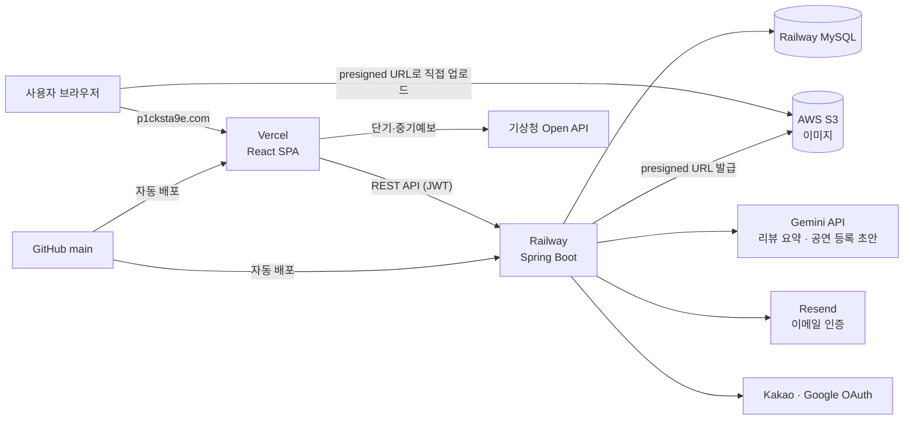
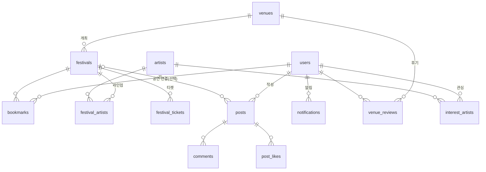

# 🎵 PICKSTAGE

> **공연·페스티벌 정보를 한곳에서.** 일정과 라인업, 티켓 오픈 알림, 공연장 후기, 동행 구하기까지 — 그리고 후기를 LLM으로 요약한 **AI 리뷰 하이라이트**를 제공하는 통합 플랫폼입니다.

- 🌐 서비스: **https://p1cksta9e.com**
- 🖥 프론트엔드 저장소: [chs731322/pickstage_frontend](https://github.com/chs731322/pickstage_frontend)
- 📄 관련 논문: 「LLM 기반 리뷰 하이라이트를 활용한 공연 정보 통합 플랫폼 설계 및 구현」 (학술대회 투고)
- 📌 API 명세서: [Notion](https://app.notion.com/p/API-3848e993af7280b0a1a0c447320ba629?source=copy_link)

이 저장소는 **백엔드(Spring Boot)** 입니다. 서비스 전체 구조는 아래 아키텍처를 참고하세요.

---

## ✨ 주요 기능

| 구분 | 기능 |
|---|---|
| **공연 탐색** | 지역·장르·일정 필터, 정렬, 검색 / 공연 상세(라인업·티켓·공연장) / 월간·주간 캘린더 |
| **개인화** | 공연 찜, 관심 아티스트 기반 맞춤 추천, 티켓 오픈 알림, 준비 체크리스트 |
| **AI 리뷰 하이라이트** | 공연·공연장 후기를 Gemini로 요약해 핵심 키워드(시야·음향·동선 등)를 뽑아 보여줌 |
| **공연장·아티스트** | 공연장 상세와 후기(시야 정보·스탠딩 팁·좌석 구역), 아티스트 상세(예정·출연했던 공연) |
| **커뮤니티** | 동행·공연후기·분실물·자유·굿즈 게시판, 블로그형 글쓰기(사진 여러 장·순서 변경·자르기), 댓글·좋아요, 정렬(최신·좋아요·조회순), 내가 쓴 글 |
| **알림** | 티켓 오픈 알림, 내 글에 달린 댓글 알림 |
| **회원** | 이메일 인증 가입, 카카오·구글 소셜 로그인, JWT 인증(Access/Refresh), 비밀번호 재설정, 탈퇴 시 개인정보 익명화 |
| **관리자** | 공지·FAQ 관리, 공연 등록·수정, **AI 공연 등록 초안**(공고 텍스트·포스터 → 초안), 회원·게시글 관리 |

---

## 🏗 아키텍처



- **배포 분리:** 프론트(Vercel) · 백엔드(Railway) · DB(Railway MySQL) · 이미지(S3)를 각각 분리해 운영하고, `main`에 푸시하면 자동 배포됩니다. 도메인은 가비아 DNS로 연결했습니다.
- **이미지 업로드:** 서버를 거치지 않고 브라우저가 S3로 직접 올립니다(서버는 presigned URL만 발급). 올리기 전에 브라우저에서 압축하고, 서버는 본문에 들어가는 사진 주소가 **우리 S3 주소인지** 검증합니다.
- **이메일:** Railway가 SMTP 포트를 막아서 SMTP 대신 Resend(HTTP API)와 도메인 인증으로 발송합니다.

---

## 🛠 기술 스택

| 분류 | 기술 |
|---|---|
| Backend | Java 21 · Spring Boot 4.1 · Spring Data JPA(Hibernate) · Spring Security · Validation |
| 인증 | JWT(jjwt) Access/Refresh · 카카오·구글 OAuth 2.0 |
| DB | MySQL 8 (Railway) |
| 스토리지 | AWS S3 (presigned URL) |
| AI | Google Gemini API (리뷰 키워드 요약, 공연 등록 초안) |
| 메일 | Resend |
| Frontend | React 19 · Vite 8 · React Router 7 · Axios |
| 배포 | Railway(API·DB) · Vercel(프론트) · GitHub 자동 배포 |
| 협업 | GitHub(브랜치 + 머지) · Notion(API 명세) |

---

## 🔌 API 개요

공통 응답 포맷은 `{ "success": true, "data": …, "message": null }` 입니다. 인증이 필요한 API는 `Authorization: Bearer {accessToken}` 헤더를 사용합니다.

| 도메인 | Base Path | 주요 엔드포인트 |
|---|---|---|
| 인증 | `/api/auth` | 이메일 중복확인·인증 발송/검증, `signup`, `signin`, `reissue`, `signout`, 카카오·구글 콜백, 비밀번호 재설정 |
| 회원 | `/api/users` | `mypage` 조회·수정·탈퇴, 비밀번호 변경, 닉네임 중복확인 |
| 공연 | `/api/festivals` | 목록(필터·정렬), 상세, `calendar`, `recommendations`(로그인) |
| 공연장 | `/api/venues` | 목록, 상세 |
| 아티스트 | `/api/artists` | 상세, 관심 등록·해제, `interests`(로그인) |
| 찜 | `/api/bookmarks` | 추가·삭제·내 목록 |
| 후기 | `/api/reviews` | 공연장 후기 작성·수정·삭제·목록 |
| AI 하이라이트 | `/api/festivals/{id}/review-highlights`<br>`/api/venues/{id}/review-highlights` | 공연·공연장 후기 요약 |
| 커뮤니티 | `/api/posts` | 목록(`category`·`festivalId`·`sort`), **`/me`**(내 글), 상세, 작성·수정·삭제, 좋아요, 댓글(`/api/posts/{id}/comments`) |
| 알림 | `/api/notifications` | 목록, 읽음 처리 |
| 체크리스트 | `/api/checklists` | 조회·추가·수정·삭제 |
| 업로드 | `/api/uploads` | `presigned-url` |
| 공지·FAQ | `/api/notices` · `/api/faqs` | 목록, 상세 |
| 관리자 | `/api/admin` | 공지·FAQ·공연 관리, **`festivals/ai-draft`**, 회원·게시글·후기 관리 |

---

## 🗂 데이터 모델

약 25개 테이블로 구성되어 있습니다. 핵심 관계는 아래와 같습니다.



**설계 원칙**
- 회원·게시글·댓글·후기는 소프트 삭제(`deleted_at`)를 적용하고, 탈퇴 시 개인정보는 익명화합니다.
- 공연·아티스트 데이터는 출처(`source`)를 구분해 저장하고, 외부 데이터 중복을 막기 위해 정규화 키를 사용합니다.
- AI 요약 결과는 `review_highlight_cache`에 대상(공연/공연장)별로 저장합니다.
- 스키마 변경은 `ddl-auto=none` 으로 두고 직접 관리합니다.

---

## 🔥 핵심 설계 · 트러블슈팅

### 1. N+1 쿼리 개선 — 공연 상세 조회
- **문제:** 공연 상세에서 라인업 아티스트를 지연 로딩해, 출연진 수만큼 추가 쿼리가 발생했습니다.
- **해결:** `JOIN FETCH`로 공연-아티스트를 한 번에 조회하도록 변경했습니다.
- **결과:** 요청당 SQL이 **라인업 90팀 기준 96개 → 6개**로 줄었습니다.

| 조건 (DB 왕복 지연) | 개선 전 | 개선 후 |
|---|---|---|
| 0ms (로컬) | 24.5ms | 7.6ms |
| 9ms | 1,099ms | **123ms (약 9배)** |
| 80ms | 8,390ms | 852ms |

> 측정 방법: 개선 전/후 코드를 각각 빌드해 같은 DB에 붙이고, **MySQL 앞에 TCP 지연 프록시**를 두어 운영 환경처럼 DB 왕복 지연(0/9/80ms)을 재현했습니다. 각 조건에서 중앙값을 비교했습니다. (로컬에서는 DB가 가까워 N+1 비용이 가려지기 때문에 지연을 주입했습니다.)

### 2. AI 리뷰 하이라이트 — 호출 비용과 지연을 줄이는 캐시 전략
- **문제:** 요청마다 Gemini를 호출하면 응답이 수 초 걸리고 호출 비용이 계속 듭니다.
- **해결:** 대상별 요약을 DB에 캐시하고, **후기 수가 바뀐 경우에만** 다시 생성합니다(생성 당시 후기 수를 함께 저장). 후기가 3개 미만이면 요약하지 않습니다.
- **결과:** 합성 후기 8건 기준, 매번 생성하면 **9,807ms** 걸리던 응답이 캐시 적중 시 **75.6ms**로 줄었습니다. (12회 측정)

### 3. 조회수가 과도하게 올라가던 문제
- **원인:** 메인 페이지 카드가 댓글 수·미리보기를 얻으려고 글마다 **상세 API**를 호출했고, 상세 API는 조회수를 올렸습니다.
- **해결:** 목록 응답에 `commentCount`·`preview`를 포함해 상세 호출을 없앴습니다. 또한 같은 방문자(계정 또는 IP)의 반복 조회는 24시간에 1회만 집계하고, 글쓴이 본인과 검색 로봇의 조회는 제외했습니다.

### 4. 서버 시간대(UTC) 문제
- **원인:** Railway 서버가 UTC라 `LocalDateTime.now()`로 저장한 글·댓글 시각이 한국 시간보다 9시간 이르게 저장됐고, 티켓 오픈 알림 스케줄러도 9시간 늦게 동작했습니다.
- **해결:** 서버 시작 시 기본 시간대를 `Asia/Seoul`로 고정했습니다.

### 5. 이미 지난 티켓 오픈 알림이 발송되던 문제
- **원인:** 오픈 시각이 이미 지난 공연을 찜해도 알림을 예약했고, 스케줄러가 곧바로 "곧 오픈됩니다"를 보냈습니다.
- **해결:** 오픈 시각이 현재보다 이전이면 알림을 만들지 않도록 수정했습니다.

### 6. AI 공연 등록 초안 (관리자)
- 공연 공고 **텍스트 또는 포스터 이미지**를 넣으면 Gemini가 구조화된 JSON(제목·장르·지역·일정·공연장·라인업)을 반환하고, 서버가 **기존 아티스트와 매칭**해 등록 초안을 만듭니다.
- 장르·지역을 **정해진 목록으로 제한**해 AI 출력이 DB 값과 어긋나지 않게 하고, 입력 크기를 검증하며, **저장은 자동으로 하지 않고 관리자가 검토한 뒤 등록**합니다.

---

## 📁 프로젝트 구조

```
src/main/java/com/pickstage/backend/
├── controller/      # API 엔드포인트
├── service/         # 비즈니스 로직 (Festival, Post, Review, ReviewHighlight, Gemini, S3 …)
├── repository/      # Spring Data JPA 리포지토리
├── entity/          # JPA 엔티티
├── dto/             # 요청/응답 객체
├── scheduler/       # 알림 스케줄러 (1분 주기)
└── global/          # 보안·JWT·CORS 설정, 공통 예외, ApiResponse
```

---

## ⚙️ 실행 방법

**요구 사항:** Java 21, MySQL 8

```bash
git clone https://github.com/chs731322/pickstage_backend.git
cd pickstage_backend

# 설정 예시 파일을 복사해서 자기 값으로 채웁니다 (복사본은 git에 올라가지 않음)
cp src/main/resources/application.properties.example src/main/resources/application.properties
./mvnw spring-boot:run        # http://localhost:8080
```

운영에서는 같은 이름의 **환경변수**(예: `GEMINI_API_KEY`)로 주입합니다.

| 분류 | 설정 키 |
|---|---|
| DB | `spring.datasource.url` · `username` · `password` |
| JWT | `jwt.secret` · `jwt.access-expiration` · `jwt.refresh-expiration` |
| S3 | `aws.s3.bucket` · `aws.s3.region` · `aws.s3.access-key` · `aws.s3.secret-key` |
| AI | `gemini.api-key` · `gemini.model` |
| 메일 | `resend.api-key` · `mail.from` |
| 소셜 로그인 | `kakao.client-id/secret/redirect-uri` · `google.client-id/secret/redirect-uri` |
| 기타 | `cors.allowed-origins` · `app.frontend-url` |

> 비밀 값은 저장소에 올리지 않습니다. 로컬 설정 파일과 운영 환경변수로만 관리합니다.

---

## 👥 팀

| 이름 | 역할 |
|---|---|
| 조해솔 | 팀장 · 백엔드 총괄, 인프라(Railway·S3·도메인), Spring Security·JWT, 공연·커뮤니티·알림 API, AI 기능 |
| 김연서 | 백엔드 — 인증(이메일·소셜 로그인), 후기 API |
| 김유희 | 프론트엔드 |
| 주은 | 디자인 |

캡스톤디자인 프로젝트로 시작해, 실제 서비스로 운영·개선하고 있습니다.
